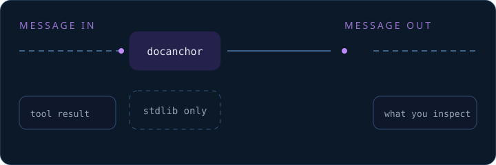

<p align="center">
  
</p>

<p align="center">
  <a href="https://pypi.org/project/docanchor/"></a>
  <a href="https://pypi.org/project/docanchor/"></a>
  <a href="https://pypi.org/project/docanchor/"></a>
  <a href="https://github.com/sandeshbagmare/docanchor/actions/workflows/ci.yml"></a>
  <a href="https://github.com/sandeshbagmare/docanchor/blob/main/LICENSE"></a>
  <a href="https://sandeshbagmare.github.io/docanchor/"></a>
  <a href="https://pypi.org/project/docanchor/"></a>
</p>

<h3 align="center">catch every broken heading anchor in your docs</h3>
<p align="center"><em>Standard library only. No runtime dependencies. Python 3.9+.</em></p>

<p align="center">
  
</p>

## Install

```console
pip install docanchor
```

## Use

```python
from docanchor import check_files

for problem in check_files(["README.md", "docs/install.md"]):
    print(problem)          # README.md:42: docs/install.md#quick-start is not ...
```

Or check a string against a resolver you control:

```python
from docanchor import check

docs = {"install.md": "## Quick start\n"}
problems = check(
    "See [install](install.md#quick-start).",
    resolve=docs.get,          # None means "cannot read"
    source="README.md",
)
```

## What counts as an anchor

- ATX headings `## Quick start` → `quick-start`
- setext headings (`Title` over `=====`) → `title`
- duplicates get `-1`, `-2`, as GitHub does, so both `#notes` and `#notes-1` work
- explicit `<a name="custom">` and any HTML `id="custom"`
- headings inside fenced code blocks are ignored, as are links there
- matching is case-insensitive

Slugs follow GitHub's rules: lowercase, inline code removed, punctuation dropped,
spaces turned into hyphens. Emoji and other symbols disappear the same way they do
on GitHub, so an emoji-only heading gets a stable (if empty) slug.

## What is skipped

- external links (`https:`, `mailto:`, …) — this is not a crawler
- links without a `#anchor`
- images (``)
- reference-style links and HTML `href`s

Those are the cases where a full link checker (or the site build) already helps.

## Development

```console
python -m venv .venv
.venv/bin/pip install -e ".[test]"
.venv/bin/pytest
```

## License

MIT.
